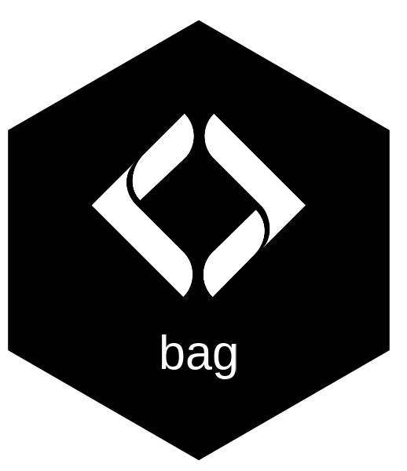

<!-- README.md is generated from README.Rmd. Please edit that file -->

```{r, include = FALSE}
knitr::opts_chunk$set(
  collapse = TRUE,
  comment = "#>",
  fig.path = "man/figures/README-",
  out.width = "100%"
)
```

# bag 

<!-- badges: start -->
[](https://lifecycle.r-lib.org/articles/stages.html#experimental)
[](https://github.com/NewGraphEnvironment/bag/actions/workflows/R-CMD-check.yaml)
<!-- badges: end -->

bag fetches public spatial data and field files, and puts them on disk where the rest of
your work can reach them: a layer behind a URL, a BC Data Catalogue record, a GeoServer
WFS endpoint, or the GPX files on a GPS unit back from the field. It then does the small
jobs that follow — convert a GeoPackage to GeoJSON, list what a data source holds, back a
file up before you change it, and move point data between geometry and UTM or
latitude/longitude columns.

The point is reproducibility. A fish-passage assessment or a restoration design rests on
data somebody downloaded once; a script that fetches it again, to a named path, with the
coordinate columns regenerated from the geometry rather than typed, is the difference
between a report you can rebuild next year and one you cannot.

Functions change between releases while the package is experimental — see
[`NEWS.md`](https://github.com/NewGraphEnvironment/bag/blob/main/NEWS.md), and pin a
release if you need one to hold still.

## Installation

```r
# install.packages("pak")
pak::pkg_install("NewGraphEnvironment/bag")

# or pin a release -- see NEWS.md for the tags
pak::pkg_install("NewGraphEnvironment/bag@vX.Y.Z")
```

`bag_url()` shells out to GDAL's `ogr2ogr` and aborts if it is not on the `PATH`. Every
other function uses GDAL through sf, which bundles its own. On macOS, `brew install gdal`;
on Ubuntu, `apt install gdal-bin`.

## What it looks like

Ask a data source what it holds, before reading any of it:

```{r layers}
library(bag)

gpkg <- system.file("extdata", "poly.gpkg", package = "bag")

# it also returns each layer's full CRS, which is a WKT block -- trimmed here
bag_layers(gpkg)[, c("name", "geomtype", "features", "fields")]
```

Write the UTM zone, easting and northing a field form expects, derived from the geometry
rather than typed in. Rows come back ordered by zone. The fourth site below was entered
before the GPS had a fix, so it has no geometry — it keeps its attributes and gets `NA`
coordinates rather than being dropped. Both warnings are the function saying what it did:

```{r utm}
sites <- sf::st_sf(
  site = c("skeena", "bulkley", "peace", "no_fix_yet"),
  geometry = sf::st_sfc(
    sf::st_point(c(-128.5, 54.5)),
    sf::st_point(c(-126.9, 54.8)),
    sf::st_point(c(-121.3, 56.2)),
    sf::st_point(),
    crs = 4326
  )
)

bag_assign_utm(sites)
```

Fetching is the other half, and it needs the network, so it is not run here:

```r
# a layer from the BC Data Catalogue, clipped to a mask, straight to a GeoPackage
bag_bcdc(
  bcdata_record_id = "pscis-assessments",
  path_gpkg = "data/pscis.gpkg",
  mask = aoi
)

# anything GDAL can open behind a URL
bag_url(
  urls = "https://example.org/layers/streams.geojson",
  path_gpkg = "data/streams.gpkg"
)

# the GPX files on a GPS unit, into one GeoPackage
bag_gpx_import(
  dir_out = "data/gps",
  layer_output_name = "2026_field",
  gpkg_name = "gps_2026"
)
```

## Learn more

Every exported function is documented at
<http://www.newgraphenvironment.com/bag/reference/>, with the reference index grouped by
what the function is for: fetching, the BC Data Catalogue, files, and coordinates. The
four coordinate and layer-listing functions carry examples that run; the other ten are
`\dontrun{}`, because they reach the network or write to disk.

## Ecosystem

bag is one of several small R packages New Graph Environment builds its reporting on.
What it fetches comes from whatever you point it at: the
[BC Data Catalogue](https://catalogue.data.gov.bc.ca/), a GeoServer WFS endpoint, or any
URL GDAL can open.

## Citation

```r
citation("bag")
```

The package is archived on Zenodo, and the DOI in `DESCRIPTION` resolves to the record.

## License

MIT © New Graph Environment Ltd.
